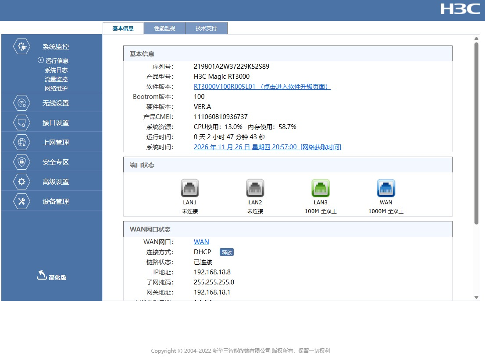

# H3C_MAGIC_RT3000

Updated firmware for the H3C Magic RT3000 HW-B from China Telecom to OpenWRT 21.02.7 QSDK 11.5

## OpenWRT 21.02.7 based on QSDK 11.5 with Hardware acceleration

Upstream repositories:

- **OpenWrt 21.02.7 / QSDK 11.5 firmware:** [https://github.com/FlyFish-go/H3C-RT3000-Product-R1](https://github.com/FlyFish-go/H3C-RT3000-Product-R1)
- **U-Boot (recommended, v0.2.0+ — auto-detects NAND & ECC at boot):** [https://github.com/FlyFish-go/IPQ50XX-Uboot](https://github.com/FlyFish-go/IPQ50XX-Uboot)
- ~~U-Boot v0.1.0 (legacy per-NAND images):~~ [https://github.com/FlyFish-go/H3C-NX30-Uboot](https://github.com/FlyFish-go/H3C-NX30-Uboot) — **legacy / superseded**; development moved to `IPQ50XX-Uboot` and this older repo is **not needed** for new installs.

### Network Setup Used in This Guide

- **Router (H3C Magic RT3000):** `192.168.10.1` (connect your PC via Ethernet to a **LAN** port — both the U-Boot rescue page and OpenWrt LuCI bind to LAN).
- **Linux helper machine:** `192.168.10.3` on the same LAN (`192.168.10.0/24`).
- **Helper automation script:** [`scripts/rt3000_helper.py`](scripts/rt3000_helper.py) (runs on `192.168.10.3`, pure Python 3 stdlib — automates hardware/NAND detection, MTD backups, and serving firmware files).

The steps are:

### 1. Activate telnet

Download the current firmware by login into the router, on the bottom you have two bottons:

- 简化版 (Basic Mode) — currently selected (grayed out)
- 专业版 (Pro/Advanced Mode) — select this one

On the left side in the menu, click the lowest button 设备管理 — Device Management. On the right side you have four tabs, the left one is active with 配置管理 — Configuration Management. Below you have 3 separate areas:

- 备份系统设置信息 — Backup System Settings
  - Button: 备份 (Backup) — This will download the plaintext configuration file RT3000.cfg
- 从文件中恢复设置信息 — Restore Settings from File
   - Button: 恢复 (Restore) — You will have to upload the fixed configuration here later
- 恢复到出厂设置 — Restore Factory Defaults
  - Button: 复原 (Factory Reset)

Download the RT3000.cfg and change line 31 to **enable** telnet, so it reads:

```cfg
@telnet
#
	telnetenable=enable
```

You can then login into the router over telnet to the IP of the router on port 23 with `telnet 192.168.10.1 23`. You get the message:

```
Connected to 192.168.10.1.
Escape character is '^]'.

 === IMPORTANT ============================
  Use 'passwd' to set your login password!
 ------------------------------------------

**************************************************************************
*    Copyright (c) 2004-2022 New H3C Technologies Co.,Ltd.               *
*    All rights Reserved.                                                *
*    Without the owner's prior written consent,                          *
*    no decompiling or reverse-engineering shall be allowed.             *
**************************************************************************

<H3C_RT3000>debugshell
```
You have to enter `debugshell` to enter the shell. You will be greeted by the old QSDK 4.4:

```
<H3C_RT3000>debugshell


BusyBox v1.30.1 () built-in shell (ash)

     MM           NM                    MMMMMMM          M       M
   $MMMMM        MMMMM                MMMMMMMMMMM      MMM     MMM
  MMMMMMMM     MM MMMMM.              MMMMM:MMMMMM:   MMMM   MMMMM
MMMM= MMMMMM  MMM   MMMM       MMMMM   MMMM  MMMMMM   MMMM  MMMMM'
MMMM=  MMMMM MMMM    MM       MMMMM    MMMM    MMMM   MMMMNMMMMM
MMMM=   MMMM  MMMMM          MMMMM     MMMM    MMMM   MMMMMMMM
MMMM=   MMMM   MMMMMM       MMMMM      MMMM    MMMM   MMMMMMMMM
MMMM=   MMMM     MMMMM,    NMMMMMMMM   MMMM    MMMM   MMMMMMMMMMM
MMMM=   MMMM      MMMMMM   MMMMMMMM    MMMM    MMMM   MMMM  MMMMMM
MMMM=   MMMM   MM    MMMM    MMMM      MMMM    MMMM   MMMM    MMMM
MMMM$ ,MMMMM  MMMMM  MMMM    MMM       MMMM   MMMMM   MMMM    MMMM
  MMMMMMM:      MMMMMMM     M         MMMMMMMMMMMM  MMMMMMM MMMMMMM
    MMMMMM       MMMMN     M           MMMMMMMMM      MMMM    MMMM
     MMMM          M                    MMMMMMM        M       M
       M
 ---------------------------------------------------------------
   For those about to rock... (Chaos Calmer, unknown)
 ---------------------------------------------------------------
root@OpenWrt:/#
```

### 2. Determine Your Hardware Group (and Check NAND Info)

> [!IMPORTANT]
> The H3C Magic RT3000 shipped with **multiple different PCBs** (`HW-A`, `HW-B`, `HW-C`). The web UI string `VER.A` and the sticker on the case (`D0` / `B0` / `C1`) do **not** reliably identify the board group. Flashing the wrong board group (`HW-A`/`B`/`C`/`D`) can brick the router (requiring a UART/TTL serial adapter to recover).
>
> With the current [**`IPQ50XX-Uboot` `v0.2.0+`**](https://github.com/FlyFish-go/IPQ50XX-Uboot/releases/tag/v0.2.0), you only need to match your **Hardware Group** (`h3c-hw-a.mbn` … `h3c-hw-d.mbn`)—the bootloader auto-detects the NAND chip and ECC mode at boot. You do **not** need the legacy 84-image per-NAND matrix from `H3C-NX30-Uboot` `v0.1.0`.

Inside `debugshell` (`root@OpenWrt:/#`), run the following **read-only** commands (or run `python3 scripts/rt3000_helper.py probe` from `192.168.10.3` to automate this entire check):

```sh
# 1. Kernel, device tree model, and MTD partition layout
uname -a
cat /proc/device-tree/model; echo
cat /proc/mtd
fw_printenv

# 2. Board machid from 0:CDT (mtd8) and 5 GHz FEM flag from 0:ART (mtd13 @ 0x26800 = 77*2048)
dd if=/dev/mtd8 bs=2048 count=1 2>/dev/null | dd bs=64 count=1 2>/dev/null | hexdump -C
dd if=/dev/mtd13 bs=2048 skip=77 count=1 2>/dev/null | dd bs=80 count=1 2>/dev/null | hexdump -C

# 3. NAND Manufacturer ID, Chip ID, model, page/OOB size, and ECC strength
dmesg | grep -iE "nand:|spi|mtd|ipq|switch|qca|rtl"
for f in name writesize erasesize oobsize ecc_strength; do
    printf "%-14s: %s\n" "$f" "$(cat /sys/class/mtd/mtd0/$f 2>/dev/null)"
done
```

#### 2.1 Identify Your Hardware Group (`HW-A` / `HW-B` / `HW-C` / `HW-D`)

Inspect `/proc/device-tree/model`, the 5-byte platform tuple in `0:CDT` (`mtd8`) at offset `0x1a` (`02 <platform> <ver> <sub_hi> <sub_lo>`), and—if `machid` is `0x08040000`—the 5 GHz calibration header in `0:ART` (`mtd13`) at offset `0x26800`:

| Hardware Group | Device Tree / FDT | CDT Tuple (`0x1a..0x1e`) → `machid` | SoC & Switch | `0:ART` @ `0x26800` (`+0x00`, `+0x3a`, `+0x45`) |
|---|---|---|---|---|
| **HW-A** | `AP-MP03.1` | `02 08 04 00 01` → `0x08040001` | IPQ5018 + QCA8337 | — |
| **HW-B** | `AP-MP02.1` | `02 08 04 00 00` → `0x08040000` | IPQ5000 + QCA8337 | `01 00 04 04`, `0x50`, `0x01` (no external 5 GHz FEM) |
| **HW-C** | `AP-MP03.1-C2` | `02 08 04 01 01` → `0x08040101` | IPQ5018 + RTL8367S | — |
| **HW-D** | `AP-MP02.1` | `02 08 04 00 00` → `0x08040000` | IPQ5000 + QCA8337 | `01 00 04 04`, `0x60`, `0x09` (external 5 GHz FEM, e.g. NX30) |

For this repository's router (verified from [`firmware/old_firmware.7z`](firmware/old_firmware.7z)):
- `0:CDT` tuple is `02 08 04 00 00` → `machid = 0x08040000` (`AP-MP02.1`).
- `0:ART` at `0x26800` has header `01 00 04 04`, `+0x3a = 0x50`, `+0x45 = 0x01` → **no external 5 GHz FEM → `HW-B`**.

#### 2.2 Verify NAND Parameters (Recommended Sanity Check)

Check the `sysfs` attributes on `mtd0`:
- `writesize` (`2048`), `erasesize` (`131072`)
- `oobsize` (`64` or `128`) and `ecc_strength` (`4` or `8`)

With [**`IPQ50XX-Uboot` `v0.2.0+`**](https://github.com/FlyFish-go/IPQ50XX-Uboot/releases/tag/v0.2.0), there is only **one file per hardware group** (`h3c-hw-a.mbn`, `h3c-hw-b.mbn`, `h3c-hw-c.mbn`, `h3c-hw-d.mbn`) because U-Boot auto-detects all supported H3C SPI NAND chips and ECC modes at boot—and displays the exact detected NAND model on the Web Rescue Page.

> [!NOTE]
> **If `dmesg | grep -i nand` prints nothing:** The router's small kernel ring buffer rolls over after some uptime and evicts the early boot `nand:` lines. This does **not** matter when using **`IPQ50XX-Uboot` `v0.2.0+`** (`h3c-hw-b.mbn`). If you ever want to read the exact NAND Manufacturer/Chip ID before flashing, run `reboot`, wait ~35 seconds, and immediately run `./rt3000_helper.py probe --host 192.168.10.1`.

<details>
<summary><strong>Legacy reference (not needed for new installs):</strong> <code>H3C-NX30-Uboot</code> v0.1.0 per-NAND table (21 chips)</summary>

> The legacy [`H3C-NX30-Uboot` `uboot-v0.1.0`](https://github.com/FlyFish-go/H3C-NX30-Uboot/releases/tag/uboot-v0.1.0) repo required manually matching your exact NAND chip ID and ECC mode from `dmesg` + `/sys/class/mtd/mtd0/` (`GD5F1GQ5REYIG` `c8:41` and `FM25LS01` `a1:a5` exist in both `ECC4` and `ECC8`). Prefer **`IPQ50XX-Uboot` `v0.2.0+`** instead.

| Mfr:Chip ID | NAND Model | Size / Page / OOB | ECC | Legacy folder inside `uboot-v0.1.0-HW-<X>.zip` |
|---|---|---|---|---|
| `2c:15` | Micron `MT29F1G01ABBFDWB-IT` | 128 MiB / 2K / 128 | 8-bit | `HW-<X>/MT29F1G01ABBFDWB-IT-ECC8/appsbl.mbn` |
| `98:d2` | Kioxia/Toshiba `TC58CYG0S3HRAIG` | 128 MiB / 2K / 128 | 8-bit | `HW-<X>/TC58CYG0S3HRAIG-ECC8/appsbl.mbn` |
| `98:db` | Kioxia/Toshiba `TC58CYG1S3HRAIJ` | 128 MiB / 2K / 64 | 4-bit | `HW-<X>/TC58CYG1S3HRAIJ-ECC4/appsbl.mbn` |
| `a1:a5` | Fudan `FM25LS01` | 128 MiB / 2K / 64 | 4-bit | `HW-<X>/FM25LS01-ECC4/appsbl.mbn` |
| `a1:a5` | Fudan `FM25LS01` | 128 MiB / 2K / 128 | 8-bit | `HW-<X>/FM25LS01-ECC8/appsbl.mbn` |
| `c2:92` | Macronix `MX35UF1GE4AC` | 128 MiB / 2K / 64 | 4-bit | `HW-<X>/MX35UF1GE4AC-ECC4/appsbl.mbn` |
| `c8:11` | ESMT `F50D1G41LB(2M)` | 128 MiB / 2K / 64 | 4-bit | `HW-<X>/F50D1G41LB-2M-ECC4/appsbl.mbn` |
| `c8:21` | GigaDevice `GD5F1GQ5REYIH` | 128 MiB / 2K / 64 | 4-bit | `HW-<X>/GD5F1GQ5REYIH-ECC4/appsbl.mbn` |
| `c8:22` | GigaDevice `GD5F2GQ5REYIH` | 256 MiB / 2K / 64 | 4-bit | `HW-<X>/GD5F2GQ5REYIH-ECC4/appsbl.mbn` |
| `c8:41` | GigaDevice `GD5F1GQ5REYIG` | 128 MiB / 2K / 128 | 4-bit | `HW-<X>/GD5F1GQ5REYIG-ECC4/appsbl.mbn` |
| `c8:41` | GigaDevice `GD5F1GQ5REYIG` | 128 MiB / 2K / 128 | 8-bit | `HW-<X>/GD5F1GQ5REYIG-ECC8/appsbl.mbn` |
| `c8:45` | GigaDevice `GD5F4GQ6REYIGY` | 128 MiB / 2K / 128 | 4-bit | `HW-<X>/GD5F4GQ6REYIGY-ECC4/appsbl.mbn` |
| `c8:81` | GigaDevice `GD5F1GM7REYIG` | 128 MiB / 2K / 128 | 8-bit | `HW-<X>/GD5F1GM7REYIG-ECC8/appsbl.mbn` |
| `c8:c1` | GigaDevice `GD5F1GQ4RE9IG` | 128 MiB / 2K / 128 | 8-bit | `HW-<X>/GD5F1GQ4RE9IG-ECC8/appsbl.mbn` |
| `c8:c9` | GigaDevice `GD5F1GQ4RE9IH` | 128 MiB / 2K / 64 | 4-bit | `HW-<X>/GD5F1GQ4RE9IH-ECC4/appsbl.mbn` |
| `e5:21` | Dosilicon `DS35M1GA-IB` | 128 MiB / 2K / 128 | 4-bit | `HW-<X>/DS35M1GA-IB-ECC4/appsbl.mbn` |
| `e5:72` | Dosilicon `DS35Q2GA` | 128 MiB / 2K / 64 | 4-bit | `HW-<X>/DS35Q2GA-ECC4/appsbl.mbn` |
| `e5:a4` | Dosilicon `DS35M4GM` | 128 MiB / 2K / 128 | 8-bit | `HW-<X>/DS35M4GM-ECC8/appsbl.mbn` |
| `ef:ba` | Winbond `W25N01GWZEIG` | 128 MiB / 2K / 64 | 4-bit | `HW-<X>/W25N01GWZEIG-ECC4/appsbl.mbn` |
| `ef:bc` | Winbond `W25N01JW` | 128 MiB / 2K / 64 | 4-bit | `HW-<X>/W25N01JW-ECC4/appsbl.mbn` |
| `ef:bf` | Winbond `W25N02JWZEIF` | 256 MiB / 2K / 64 | 4-bit | `HW-<X>/W25N02JWZEIF-ECC4/appsbl.mbn` |

</details>

---

### 3. Back Up All Original Partitions to `192.168.10.3`

Before modifying U-Boot or any system partition, dump `mtd0` through `mtd15` from the router to your Linux machine (`192.168.10.3`). Keep the backup locally and privately—it contains your unit's unique Wi-Fi calibration data (`0:ART`), MAC addresses, and serial number.

> If you already dumped `mtd0`–`mtd15` into [`firmware/old_firmware.7z`](firmware/old_firmware.7z) and verified `md5sums.txt`, you already have this backup!

**Automated backup from `192.168.10.3`:**

```bash
python3 scripts/rt3000_helper.py backup --host 192.168.10.1 --local-ip 192.168.10.3 --out ./backup_rt3000 --7z
```

**Manual backup (streaming `mtd15` without filling the router's RAM `/tmp`):**

On the Linux machine (`192.168.10.3`):

```bash
nc -l -p 9000 > mtd15_rootfs.bin
```

On the router (`192.168.10.1` in `debugshell`):

```sh
dd if=/dev/mtd15 bs=4096 | nc 192.168.10.3 9000
dd if=/dev/mtd15 bs=4096 | md5sum
```

Verify that `mtd15_rootfs.bin` on `192.168.10.3` is exactly `41943040` bytes (40 MiB) and its `md5sum` matches the router's output. Repeat for `mtd0`–`mtd14` (especially `mtd0` `0:SBL1`, `mtd1` `0:MIBIB`, `mtd2`/`mtd3` `0:BOOTCONFIG*`, `mtd8` `0:CDT`, `mtd10` `0:APPSBLENV`, `mtd11`/`mtd12` `0:APPSBL*`, and `mtd13` `0:ART`).

---

### 4. Install the Replacement U-Boot

You have two ways to install U-Boot. **Do NOT upload `appsbl.mbn` directly to the stock H3C web UI firmware upgrade page**—the stock web UI only accepts signed vendor upgrade packages.

#### Option A: Direct Flash via Telnet + Linux Machine (`192.168.10.3`)

Use this path when Telnet (`debugshell`) is already active on `RT3000V100R005L01` and you do not want to upgrade stock firmware to `RT3000V100R015` first.

1. **Download and verify U-Boot (`IPQ50XX-Uboot` `v0.2.0+`) on `192.168.10.3`:**
   Use `./rt3000_helper.py releases --hw HW-B` to get the latest download URL and SHA-256, or download directly from [`IPQ50XX-Uboot` `v0.2.0`](https://github.com/FlyFish-go/IPQ50XX-Uboot/releases/tag/v0.2.0) (replace `hw-b` if your board group differs):

   ```bash
   mkdir -p ~/rt3000-stage && cd ~/rt3000-stage
   curl -LO https://github.com/FlyFish-go/IPQ50XX-Uboot/releases/download/v0.2.0/h3c-hw-b.mbn
   curl -LO https://github.com/FlyFish-go/IPQ50XX-Uboot/releases/download/v0.2.0/SHA256SUMS
   grep h3c-hw-b.mbn SHA256SUMS | sha256sum -c -
   ```

2. **Serve the U-Boot image from `192.168.10.3`:**
   Run the helper script (which prints exact copy-paste `wget`, `sha256sum`, and dual-slot flash commands):

   ```bash
   ./rt3000_helper.py serve ~/rt3000-stage/h3c-hw-b.mbn --local-ip 192.168.10.3 --port 8899
   ```

   *(Or manually with Python: `cd ~/rt3000-stage && python3 -m http.server 8899 --bind 192.168.10.3`.)*

3. **Download and verify on the router (`debugshell`):**

   ```sh
   cd /tmp
   wget http://192.168.10.3:8899/h3c-hw-b.mbn -O /tmp/appsbl.mbn
   sha256sum /tmp/appsbl.mbn
   ls -l /tmp/appsbl.mbn
   ```

   **Stop immediately** if the SHA-256 does not match `SHA256SUMS` and your Linux host's `sha256sum`.

4. **Pre-flash safety checks on the router (`debugshell`):**

   Confirm that `mtd11` and `mtd12` are `0:APPSBL` and `0:APPSBL_1` (each `0x00140000` = 1,310,720 bytes, erase size `0x00020000`), have **0 bad blocks**, and check which flash utility is installed:

   ```sh
   cat /proc/mtd | grep -E "mtd11|mtd12"
   # Expected:
   # mtd11: 00140000 00020000 "0:APPSBL"
   # mtd12: 00140000 00020000 "0:APPSBL_1"

   cat /sys/class/mtd/mtd11/bad_blocks /sys/class/mtd/mtd12/bad_blocks
   # Expected: 0 and 0

   which mtd flash_erase nandwrite
   ```

   > [!CAUTION]
   > - **Never use `dd` to write to NAND `/dev/mtd*`!** Always use `mtd write` or `flash_erase` + `nandwrite -p`.
   > - If either `mtd11` or `mtd12` has a non-zero `bad_blocks` count, or their names/sizes differ from `00140000`, **stop** and do not flash.
   > - Always write the **inactive/backup copy (`mtd12` / `0:APPSBL_1`) first** and verify its readback SHA-256 **before** touching the active copy (`mtd11` / `0:APPSBL`). That way, if writing fails, your active bootloader is still intact. (Verify `0:APPSBL` selector is `0` first via `rt3000_helper.py probe`; if selector is `1`, swap the order and write `mtd11` first.)

5. **Write backup copy (`mtd12` / `0:APPSBL_1`) and verify readback:**

   ```sh
   SIZE=$(wc -c < /tmp/appsbl.mbn)

   # Using OpenWrt mtd (standard on stock QSDK 4.4):
   mtd write /tmp/appsbl.mbn /dev/mtd12
   # (Alternatively, if mtd is absent and mtd-utils is present:
   #  flash_erase /dev/mtd12 0 0 && nandwrite -p /dev/mtd12 /tmp/appsbl.mbn)

   # Read back exact image size and compare SHA-256:
   dd if=/dev/mtd12 bs=1 count="$SIZE" 2>/dev/null | sha256sum
   sha256sum /tmp/appsbl.mbn
   ```

   **Only proceed if both SHA-256 hashes are 100% identical.**

6. **Write active copy (`mtd11` / `0:APPSBL`) and verify readback:**

   ```sh
   mtd write /tmp/appsbl.mbn /dev/mtd11

   dd if=/dev/mtd11 bs=1 count="$SIZE" 2>/dev/null | sha256sum
   sha256sum /tmp/appsbl.mbn
   ```

   Once **both** `mtd11` and `mtd12` pass readback SHA-256 verification (and `0:APPSBLENV` / `mtd10` has not been touched), sync and reboot:

   ```sh
   sync
   reboot
   ```

   After rebooting, the router will boot back into the stock firmware normally via the new U-Boot.

#### Option B: Upstream BootBridge Web (Browser-Guided Installer)

If you prefer FlyFish-go's officially tested browser-guided installer:
1. First upgrade the router's stock firmware to **`RT3000V100R015`** via the H3C stock web UI (BootBridge checks the exact SHA-256 of the stock firmware file and refuses other versions).
2. Open [BootBridge Web (`IPQ50XX-Uboot` v0.2.0)](https://flyfish-go.github.io/IPQ50XX-Uboot/bootbridge/) in a browser on `192.168.10.3`, select **RT3000**, feed it the official `RT3000V100R015` file to generate the bridge image locally in the browser, and upload that bridge image in the H3C stock web UI.
3. After reboot, open `http://192.168.10.1` over a LAN cable and follow the wizard (**Detect → Backup → Install**).

---

### 5. Prepare the OpenWrt 21.02.7 Firmware Archive on `192.168.10.3`

Extract the downloaded firmware `.7z` archive from your downloads folder on `192.168.10.3`:

```bash
mkdir -p ~/rt3000-openwrt && cd ~/rt3000-openwrt
7z x ~/Downloads/<your-firmware-archive>.7z
ls -lh
sha256sum *.ubi *.bin 2>/dev/null
```

> If you need the latest OpenWrt 21.02.7 (QSDK 11.5) build directly from upstream, download the matching release files from [`FlyFish-go/H3C-RT3000-Product-R1` Releases](https://github.com/FlyFish-go/H3C-RT3000-Product-R1/releases) (e.g. `r14`):
> - **First install (U-Boot Web Rescue Page):** `H3C-Magic-r14-HW-B-nand-factory.ubi` (replace `HW-B` with your board group)
> - **Future upgrades (inside OpenWrt LuCI):** `H3C-Magic-r14-HW-B-sysupgrade.bin`

Always verify the `.ubi` file's `sha256sum` against the release notes before flashing.

---

### 6. Flash OpenWrt 21.02.7 via the U-Boot Web Rescue Page

1. **Enter the U-Boot Web Rescue Page:**
   - Unplug power from the RT3000.
   - Hold down the **Reset** button (or the **Mesh/WPS** button on U-Boot `v0.1.0+`, which is easier to press).
   - Plug power back in while holding the button.
   - Watch the red LED blink once per second: **release after the 3rd red flash** (the LED turns solid green).
2. **Open the rescue interface from `192.168.10.3`:**
   - Ensure `192.168.10.3` is wired directly to a **LAN** port on the RT3000 (your static `192.168.10.3/24` address is already in the right subnet; U-Boot also runs a DHCP server handing out `192.168.10.100`–`192.168.10.200`).
   - Open `http://192.168.10.1` in your browser.
3. **Check System Info:**
   - Verify the reported **Hardware Family** (e.g. `HW-B`), detected **NAND model / ECC**, and **5 GHz FEM** status.
   - Confirm that the firmware `.ubi` file you extracted matches the displayed **Hardware Family**.
4. **Flash OpenWrt into the Second System Slot (Dual-Boot):**
   - Go to **Firmware Update** on the rescue page.
   - Select the slot that does **not** contain the stock firmware (slots are shown by offset: Slot 1 = `0x900000`, Slot 2 = `0x3100000`; stock is normally in Slot 1, so select **Slot 2 / `0x3100000`**).
   - Upload `H3C-Magic-r14-HW-B-nand-factory.ubi` (your extracted `*-nand-factory.ubi` file) and wait for write + verification to complete.
   - *(Optional: if you do **not** want to keep the stock H3C firmware and need extra flash space for large packages like OpenClash/PassWall/Tailscale, you can merge both slots into a single **80 MiB** partition on the rescue page's partition-table tab before flashing `.ubi`. This erases the stock system.)*
5. **Set Default Boot Slot & Reboot:**
   - On the rescue page overview, set the newly flashed OpenWrt slot as the **Default Boot** slot and reboot / power-cycle the router.

---

### 7. First Boot, Security Hardening & Dual-Boot Switching

After rebooting (~60 seconds), connect to OpenWrt 21.02.7 (QSDK 11.5):

- **Web UI (LuCI):** `http://192.168.10.1/` (LAN only)
- **SSH:** `ssh root@192.168.10.1` (LAN only, **no root password** on first boot!)
- **Default Wi-Fi:** `OpenWrt` (2.4 GHz) and `OpenWrt-5G` (5 GHz), WPA2 password `12345678`, country `CN`.

Immediately secure the router after first login:

```sh
# Over SSH from 192.168.10.3:
ssh root@192.168.10.1
passwd
```

Then open LuCI (`http://192.168.10.1/`) to:
1. Change the Wi-Fi SSIDs, WPA2/WPA3 passwords, and regulatory country code.
2. Verify WAN/LAN connectivity and NSS hardware offload (`940 Mbps` wired NAT).

#### Switching Between OpenWrt and Stock Firmware (Dual-Boot)

With U-Boot `v0.1.0+` / `v0.2.0+`, you can switch slots without a PC by holding **Reset** or **Mesh/WPS** while powering on:

| Release Timing (Red LED) | Action |
|---|---|
| Before 1st flash | Normal boot of default slot |
| After **1st** flash | Boot **Slot 1** (`0x900000`, typically stock) and set as default |
| After **2nd** flash | Boot **Slot 2** (`0x3100000`, typically OpenWrt) and set as default |
| After **3rd** flash | Enter **Web Rescue Page** (`http://192.168.10.1`) |

#### Future OpenWrt Upgrades

Once OpenWrt 21.02.7 is running, upgrade future releases via LuCI (**System → Backup / Flash Firmware**) using the `*-sysupgrade.bin` image (settings can be preserved; `r14` also supports **Online Update** in LuCI).

---

### 8. Automation with the Linux Machine (`192.168.10.3`)

Because `192.168.10.3` is on the same LAN as the router, [`scripts/rt3000_helper.py`](scripts/rt3000_helper.py) automates the error-prone discovery, backup, and file-serving steps using only Python 3's standard library (no `pip` packages required):

```bash
# 1. Probe live router via Telnet (read-only): detects HW group, NAND ID, ECC,
#    and prints the exact U-Boot & OpenWrt filenames (use --check-latest for future r15+ releases)
python3 scripts/rt3000_helper.py probe --host 192.168.10.1 --check-latest

# 2. Or inspect an existing .7z MTD backup offline (decodes CDT, ART FEM, BOOTCONFIG, env)
python3 scripts/rt3000_helper.py inspect-backup firmware/old_firmware.7z

# 3. Check latest upstream OpenWrt (r14 / future updates) & U-Boot download URLs + SHA-256 digests
python3 scripts/rt3000_helper.py releases --hw HW-B

# 4. Automatically stream & verify mtd0..mtd15 backup from router to 192.168.10.3
python3 scripts/rt3000_helper.py backup --host 192.168.10.1 --local-ip 192.168.10.3 --out ./backup_rt3000 --7z

# 5. Stage a .7z/.zip or directory, print SHA-256 hashes, start HTTP server on 192.168.10.3:8899,
#    and print exact copy-paste wget / sha256sum / flash or sysupgrade commands
python3 scripts/rt3000_helper.py serve ~/Downloads/<archive>.7z --local-ip 192.168.10.3 --port 8899
```

> [!NOTE]
> By design, `rt3000_helper.py` **never writes to flash automatically** over Telnet—it prints the exact verified commands with matching SHA-256 digests so you can confirm every check before erasing `0:APPSBL_1` / `0:APPSBL`.

## Original Firmware



### 基本信息
```
序列号：		219801A2W37229K52S89
产品型号：		H3C Magic RT3000
软件版本：		RT3000V100R005L01 （点击进入软件升级页面）
Bootrom版本：		100
硬件版本：		VER.A
产品CMEI：		111060810936737
系统资源：		CPU使用：15.0%   内存使用：58.7%
运行时间：		0 天 2 小时 48 分钟 13 秒
系统时间：		2026 年 11 月 26 日 星期四 20:57:31  [网络获取时间]
```

### 端口状态

```
LAN1	LAN2	LAN3	WAN	
未连接	未连接	100M 全双工	1000M 全双工
```

### WAN网口状态

```
WAN网口：		WAN
连接方式：		
DHCP		
链路状态：		已连接
IP地址：		192.168.18.8
子网掩码：		255.255.255.0
网关地址：		192.168.18.1
主DNS服务器：		1.1.1.1
辅DNS服务器：		8.8.8.8
DHCP剩余时间：		00:43:18
MAC地址：		10:9F:4F:5C:A0:99
```

### IPv6

```
IPv6 已关闭		
    自动刷新：
```

## Firmware

If you login via telnet you will be surprized that both the firmware is based on OpenWRT and on the other hand 11 years old!

```
<H3C_RT3000>debugshell

BusyBox v1.30.1 () built-in shell (ash)

     MM           NM                    MMMMMMM          M       M
   $MMMMM        MMMMM                MMMMMMMMMMM      MMM     MMM
  MMMMMMMM     MM MMMMM.              MMMMM:MMMMMM:   MMMM   MMMMM
MMMM= MMMMMM  MMM   MMMM       MMMMM   MMMM  MMMMMM   MMMM  MMMMM'
MMMM=  MMMMM MMMM    MM       MMMMM    MMMM    MMMM   MMMMNMMMMM
MMMM=   MMMM  MMMMM          MMMMM     MMMM    MMMM   MMMMMMMM
MMMM=   MMMM   MMMMMM       MMMMM      MMMM    MMMM   MMMMMMMMM
MMMM=   MMMM     MMMMM,    NMMMMMMMM   MMMM    MMMM   MMMMMMMMMMM
MMMM=   MMMM      MMMMMM   MMMMMMMM    MMMM    MMMM   MMMM  MMMMMM
MMMM=   MMMM   MM    MMMM    MMMM      MMMM    MMMM   MMMM    MMMM
MMMM$ ,MMMMM  MMMMM  MMMM    MMM       MMMM   MMMMM   MMMM    MMMM
  MMMMMMM:      MMMMMMM     M         MMMMMMMMMMMM  MMMMMMM MMMMMMM
    MMMMMM       MMMMN     M           MMMMMMMMM      MMMM    MMMM
     MMMM          M                    MMMMMMM        M       M
       M
 ---------------------------------------------------------------
   For those about to rock... (Chaos Calmer, unknown)
 ---------------------------------------------------------------
root@OpenWrt:/tmp/backup# uname -a
Linux OpenWrt 4.4.60 #1 SMP PREEMPT Sat Aug 20 13:36:05 CST 2022 armv7l GNU/Linux
```

Yes, Chaos Calmer is from Septemebr 2015 for OpenWRT 15.05. At least QSDK 4.4 with Kernel 4.460 is a little younger. 
