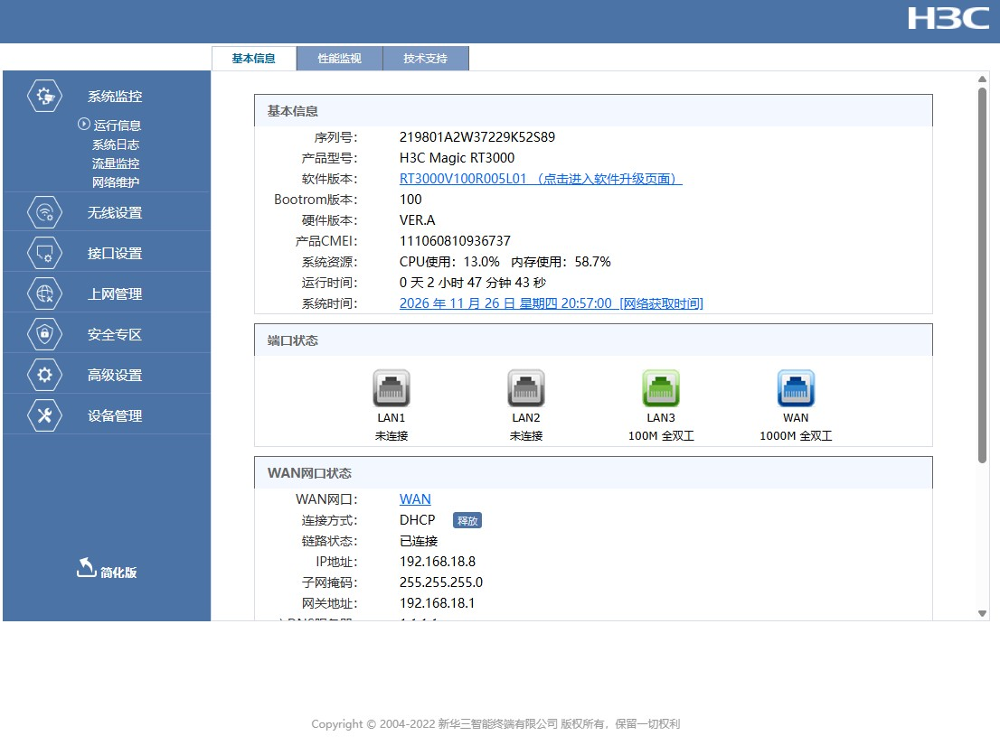

# Documentation of the hardware

Even though it has two Cortex-A53 core it runs on a 32bit operating system. With 256 MiB RAM it's probably enough. Additionally 128 MiB Flash, divided into two banks of 40 MiB to switch firmwares.

This is the original layout - probably sufficient for OpenWRT for a few years.

That's how the UI looks when logging in:

